  <picture>
    <source media="(prefers-color-scheme: dark)" srcset="./hero-grid.svg" />
    <source media="(prefers-color-scheme: light)" srcset="./hero-grid.svg" />
    
  </picture>

# 💫 About Me:
👯. Disponível para colaborar em projetos Open Source 🌱. Desenvolvendo compoetências em Cloud Computing e devops engineer 💬. Interesse em cybersecurity e MCP para agentes de IA

  <!-- ANIMAÇÃO #1: mini-terminal com retrato ASCII híbrido -->
  <picture>
    <source media="(prefers-color-scheme: dark)" srcset="./m-dark.svg" />
    <source media="(prefers-color-scheme: light)" srcset="./m-light.svg" />
    
  </picture>

# 💻 Tech Stack:
                                                      
# 🛠 Engineering Stack

**Cloud & DevOps**  
Google Cloud · Google Cloud Monitoring · Azure · Docker · Kubernetes · GitHub Actions · Nginx · Terraform · Linux · PowerShell

**Backend**  
Python · FastAPI · Flask · gRPC · C · C++ · Java · JWT · APIs · Bots / automação

**AI & Automation**  
MCP · TensorFlow · PyTorch · Scikit-learn · OpenCV · Automation pipelines

**Cybersecurity**  
Cisco fundamentals · Tor · Security concepts

**Databases**  
MySQL · PostgreSQL · SQLite · MongoDB · Redis

**Tools**  
Git · GitHub · VS Code · Postman · Blender · Canva · Datadog · Trello · Anaconda · Windows Terminal · Apache Jena

# 📊 GitHub Stats:
 
 

  <picture>
    <source
      media="(prefers-color-scheme: dark)"
      srcset="https://raw.githubusercontent.com/VaibhavKhushalani/github-snake/output/github-snake-dark.svg"
    />
    <source
      media="(prefers-color-scheme: light)"
      srcset="https://raw.githubusercontent.com/VaibhavKhushalani/github-snake/output/github-snake.svg"
    />
    
  </picture>

### 🔝 Top Contributed Repo

  ## 💰 You can help me by Donating
   

  
<!-- Proudly created with GPRM ( https://gprm.itsvg.in ) -->
